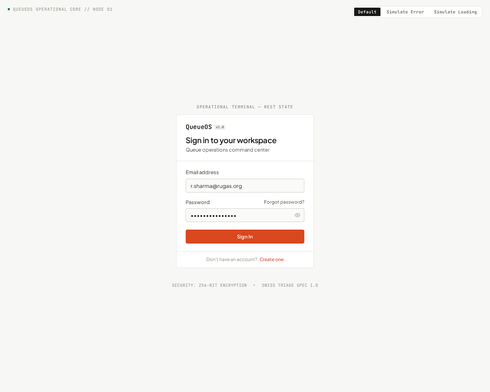
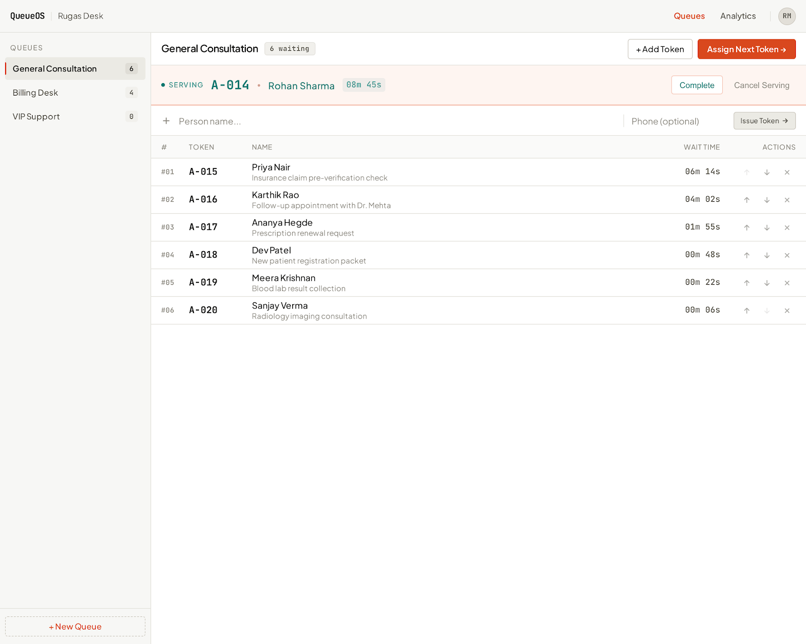
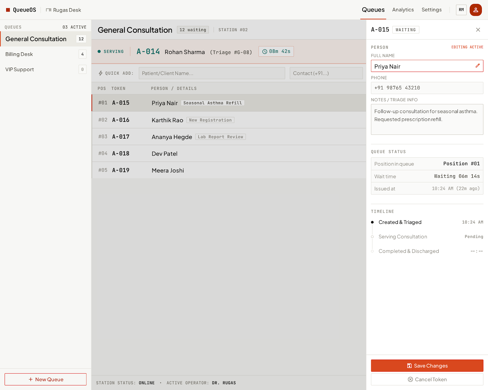
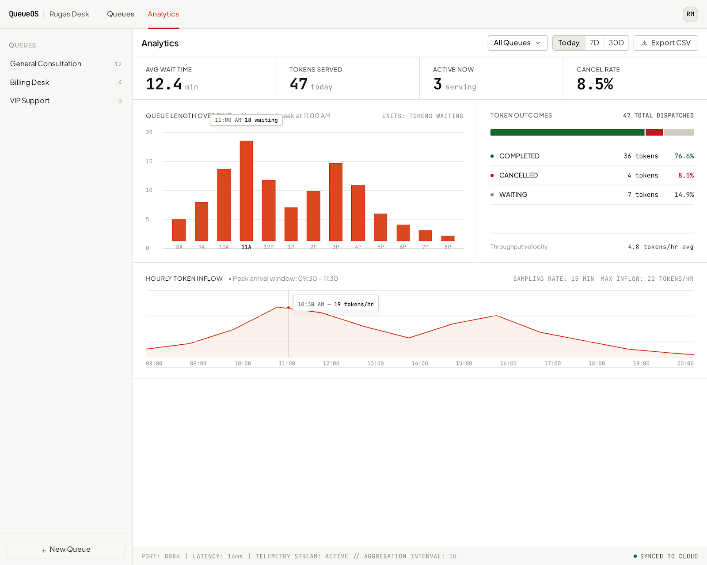
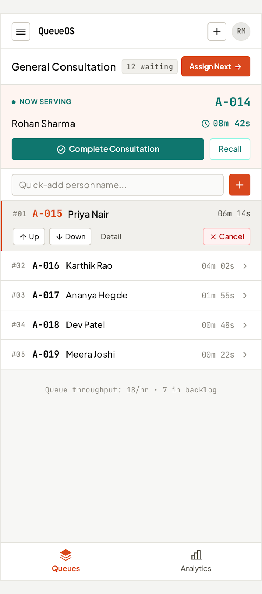

<div align="center">
  
  <h1>QueueOS</h1>
  <p><strong>A real-time queue and service-desk management system</strong></p>
  <p>Manage service lines, issue and dispatch tokens, and understand queue activity from one operational workspace.</p>
</div>

---

## Overview

QueueOS is a queue operations dashboard for teams that serve visitors through one or more service lines. Managers can create queues, issue numbered tokens, organize the waiting line, call the next person, and review queue activity and analytics.

The interface follows a practical **Swiss Triage** design direction: warm neutral surfaces, fine structural borders, information-dense layouts, tabular metrics, and a focused vermilion primary action. It is built with Next.js App Router, TypeScript, MongoDB, and Mongoose.

## Screenshots

The screenshots below are design previews included in the repository under `_stitch-exports/stitch_queueos_workspace_interface/`.

### Sign in



### Queue workspace



### Token details



### Analytics dashboard



### Mobile workspace



## Features

- **Manager accounts and workspace isolation** — Sign-up and sign-in flows use `bcryptjs` password hashing and `jose`-signed JWT session cookies. Queue and token records are associated with their manager.
- **Multiple service queues** — Create and switch between named queues, each with its own token prefix and counter.
- **Quick token issuance** — Add a visitor to a queue with a name and optional contact details. Sequential token identifiers are generated from the queue counter.
- **Waiting-line management** — View waiting tokens and adjust their order with adjacent move-up and move-down controls. The token model stores a position for queue ordering.
- **Token lifecycle** — Track `WAITING`, `SERVING`, `COMPLETED`, and `CANCELLED` states, with timestamps for creation, service, completion, and cancellation.
- **Next-token dispatch** — Promote the next waiting token to service and record its service time; the workspace is designed for quick desk turnovers.
- **Queue analytics** — Review operational metrics and trends through an analytics dashboard with Visx visualizations.
- **Responsive operational UI** — A queue workspace and mobile-oriented layout, with GSAP and NumberFlow used in the interface for motion and changing values.

## Technology

| Area | Stack |
| --- | --- |
| Application | Next.js 16 App Router, React 19, TypeScript |
| Data | MongoDB, Mongoose |
| Authentication | `jose`, `bcryptjs` |
| Validation | Zod |
| Styling | Tailwind CSS 4 and custom CSS |
| Visualization | Visx (`@visx/axis`, `@visx/group`, `@visx/scale`, `@visx/shape`) |
| Motion and metrics | GSAP, `@gsap/react`, `@number-flow/react`, Motion |

## Getting started

### Requirements

- Node.js 20.9 or later
- npm
- A MongoDB database (MongoDB Atlas or a local instance)

### 1. Clone the repository

```bash
git clone https://github.com/only-vikas/Queue_Manage.git
cd Queue_Manage
```

### 2. Install dependencies

```bash
npm install
```

### 3. Configure environment variables

Create a `.env.local` file in the project root. You can start from the provided example:

```bash
cp .env.example .env.local
```

Set the following values in `.env.local`:

```dotenv
MONGODB_URI=mongodb+srv://<username>:<password>@<cluster>.mongodb.net/queueos?retryWrites=true&w=majority
JWT_SECRET=<a-long-random-secret>
```

Use a strong, private value for `JWT_SECRET`. Do not commit `.env.local` or share your database credentials.

### 4. Start the development server

```bash
npm run dev
```

Open [http://localhost:3000](http://localhost:3000), create an account, and set up a queue.

## Available scripts

| Command | Description |
| --- | --- |
| `npm run dev` | Start the Next.js development server |
| `npm run build` | Create a production build |
| `npm run start` | Start the production server |
| `npm run lint` | Run ESLint |

## Data model

QueueOS uses three Mongoose models:

- **Manager** — Manager identity, unique email, password hash, and workspace name.
- **Queue** — Owning manager, queue name and prefix, sequential token counter, and active state. Queue names are unique per manager.
- **Token** — Queue and manager references, token identifier, visitor details, status, queue position, and lifecycle timestamps.

Tokens use the statuses `WAITING`, `SERVING`, `COMPLETED`, and `CANCELLED`. The token schema defines indexes to support queue/status/position lookups and manager/date queries.

## Project structure

```text
src/
├── app/
│   ├── (auth)/                 # Sign-in and sign-up pages
│   ├── (dashboard)/            # Queue and analytics pages
│   ├── api/                    # Auth, queue, token, and analytics route handlers
│   ├── globals.css             # Global styles and design tokens
│   └── layout.tsx              # Root application layout
├── components/
│   ├── analytics/              # Analytics components
│   ├── modals/                 # Dialogs and confirmations
│   ├── shell/                  # Application shell and navigation
│   └── ui/                     # Shared interface components
├── lib/                        # Shared application utilities
└── models/                     # Manager, Queue, and Token Mongoose models
```

## Deployment

QueueOS can be deployed to a Node.js hosting platform such as Vercel. Configure `MONGODB_URI` and `JWT_SECRET` in the deployment environment before building and deploying. Keep production credentials in the hosting provider's secret or environment-variable settings rather than in source control.

## License

No license is currently specified in this repository. Contact the repository owner before redistributing or reusing the project.
